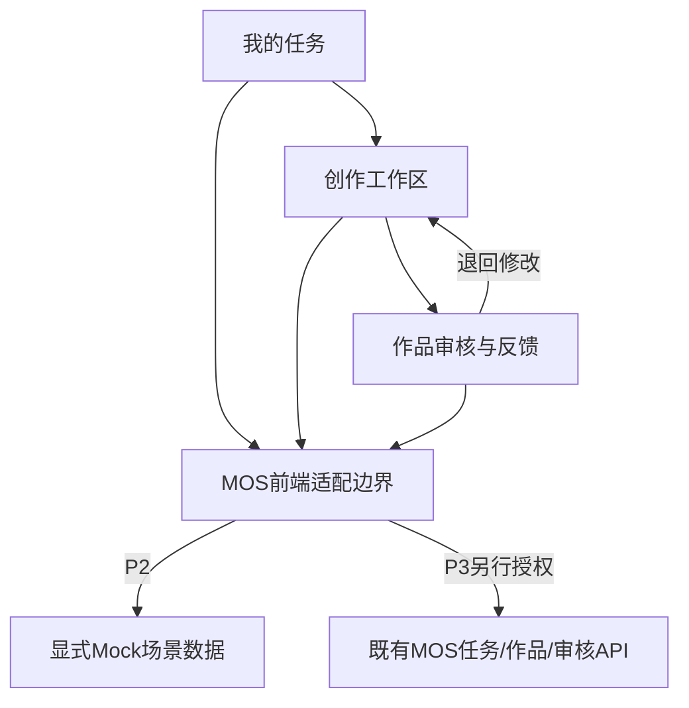

# P0-04 前端路线决策

日期：2026-11-02。状态：R2为P0推荐，尚未实施。依据为现有MOS源码与固定上游快照，不以Star数、截图或未经运行的功能清单评分。

## 路线比较

| 维度 | R1原生前端继续演进 | R2独立组件化试点 | R3整体fork主系统 |
|---|---|---|---|
| 保护现有API和权限 | 容易保留 | 适配层可保留 | 要处理身份/数据/审批模型替换 |
| 三页共享对话/作品/反馈状态 | 需自建组件、生命周期和状态规范 | 更适合明确组件与状态边界 | 框架已有，但语义属于另一系统 |
| 复用上游经验 | 只能参考交互 | 可参考组件分层，局部源码须单独评估 | 源码量大、耦合和许可负担高 |
| 新依赖/构建成本 | 小 | 适中，需要版本与供应链审查 | 大，还要承担整套服务维护 |
| 原型隔离/回滚 | 可以 | 可采用独立静态入口 | 难以避免第二套业务权威 |
| 本次判断 | 可作为技术回退方案 | **推荐** | 当前不推荐 |

R1并非不能做好体验，但当前字符串模板、全局挂载和业务组件混合的方式，需要先补足大量交互状态基础。R2以有限试点承担这部分投入，避免在同一模板中反复堆功能。R3没有证据证明能降低整体维护与业务适配成本。

## 推荐结构

拟采用React+TypeScript、轻量独立构建（Vite候选），只承载三个场景：MyTasks、CreativeWorkspace、WorkReview。它们与TaskContext、DraftState、ArtifactPreview、FeedbackPanel、CapabilityState等小组件组合，不把三个第三方后台嵌进来。

具体React/Vite/TypeScript版本必须在P2开始前根据支持范围、依赖公告和许可核对后固定；本轮不指定“最新版本”，不安装。先不引入Recoil/Jotai/MobX三套状态、不复制LibreChat的Provider树、不复制Plane的富文本/Store体系，不为原型增加微服务。

P2只使用独立loopback静态原型与合成数据，不接真实业务库、不借用真实登录Cookie、不自动代理MOS或外网。Mock模式和真实模式不可静默切换。P3再考虑同源新入口与现有HttpOnly会话/CSRF，保持单一身份权威；不能默认用iframe或第三方登录替代。

## 适配边界要求

| 前端对象/动作 | 绑定要求 |
|---|---|
| TaskContext | actor/brand/task明确绑定；品牌/用户变化取消旧读取并失效缓存 |
| Draft | 以用户+品牌+任务+作品版本区分；明确内存、服务器已存、未知提交结果 |
| Conversation | 不直接等同ContentVersion；消息ID与作品ID分离 |
| SelectedArtifact | 用户确认正文/附件后形成作品，不默认提交全部对话 |
| Save/Submit | 等待真实持久化结果，捕获编辑revision和rowVersion；失败不继续lock |
| Review | 以服务端canDecide/allowedActions和冻结版本为准，保留专业/发布分离 |
| ModelCapabilities | 文件、图片、视频、流式、中止分别声明；不根据按钮存在推断可用 |
| Error | 区分未配置、无权限、预算、冲突、断网、保存结果未知，提供恢复动作 |

读取可以取消或忽略旧响应；已经发送的写入不能因界面取消而宣称服务器未执行。草稿恢复、幂等交付和多HTTP部分成功属于P3设计，不能由组件框架自动解决。

## 可行性和回退

静态可行依据：MOS已有所需核心API，上游交互可在不复制其业务模型的前提下参考。未证明部分：新构建在本机运行、包版本兼容、CSS/可访问性、员工试用、生产同源部署。

P2先做最小构建与三页导航技术验证，若环境或维护成本明显超出范围，记录具体失败并重新比较R1；不擅自改为R3。P1应保持交互设计与框架解耦。P2构建、P3接API和正式替换均需要对应阶段授权，P0结束不继续。
