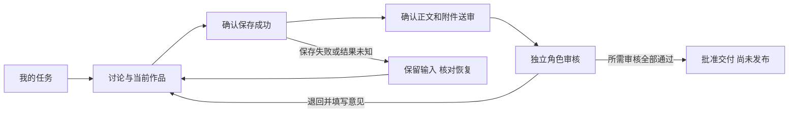

# P1-01 布局与操作流

日期：2026-11-02；设计来源为P0场景及用户对碎片化、文档化体验的反馈。角色和业务语义沿用MOS；没有新增权限或改API。

## 公共外壳

桌面画板1440×960，保留六区导航，当前分区展开，其余折叠；主任务流程不要求从一个中心切换到另一个中心。顶部始终显示当前品牌和登录身份；任务、作品及草稿上下文不可脱离品牌。默认个人队列，团队视图及系统配置按权限呈现。

首屏只放任务名称、当前阶段和下一步；说明只在空状态、错误或确认时出现。历史、技术编号、完整制作工具和高级筛选仍可找到，不以删除功能减少复杂度。

绘图中的林悦为合成运营/制作角色；“待我审核”只在实际身份有对应能力时展示，不能照抄画板计数给所有人。陈岚为独立专业审核人，审核图顶部身份与当前职责一致，不代表技术管理员可以批准。

## A 我的任务

对应01/04画板，状态T01—T06。

- 标题“我的任务”，主视图“待我处理”；次级视图待修改、待我审核、临近截止、全部。
- 每项包含名称、当前要求或最新反馈、负责人、截止及下一步。不默认铺开平台/风险/栏目/叙事/关联ID。
- 下一步按任务真实状态和能力呈现：继续创作、按反馈修改、查看要求、处理审核；不在同一行重复“详情、编辑、审核、生成”等动作。
- 从当前行一次主要操作进入同一任务上下文。搜索及更多筛选保留，结果为空不等于没有任务。
- 发起任务的必要项优先：标题、要求、负责人、截止；高级发布要求展开后处理。负责人选项不代替服务端授权校验。
- 已完成/取消、项目总览仍可从全部/现有项目入口查看，不删除记录。

默认排序建议：需要修改/明确阻塞优先，再按逾期、截止和更新时间；这是显示规则，须P2试用验证，不改数据库状态或自动催办。

## B 创作工作区

对应02/05画板，状态C01—C18。

桌面：左侧讨论与修改，右侧当前作品；任务要求与资料在上下文抽屉，不再固定占第三栏。默认让作品区域更宽。顶部显示任务与保存状态。自由创作时明确“尚未关联任务”，选定后保存才要求选择位置。

1. 输入需求→生成候选→继续讨论；发送按钮只管理讨论，不是保存作品。
2. “选为当前作品”将该候选放入作品区域供整理；已有未保存修改时必须先保存或明确确认替换，并保留恢复路径。
3. 当前作品修改后主动作是“保存作品”。生成更多候选不会覆盖作品。
4. 保存确认成功且没有更新编辑、附件就绪、有送审权限后，主动作才变为“提交审核”。保存中或失败时不能提交。
5. 确认框列明本次正文与勾选附件，聊天不送审；确认后冻结该已知版本。提交成功后转只读并显示审核反馈。

不同操作区域可以分别有发送与保存动作，但同一区域同一时刻只有一个主要动作。未保存时不让“送审”与“保存”并列竞争；禁用送审要给出原因。

附件分为任务附件和用于生成的资料。上传成功、获得授权、随某次请求发送、模型能否读取是不同状态；不能显示笼统的“已理解”。画板文件chip明确未用于生成。模型/格式不支持时可保留为任务附件，但不能假装已作为模型上下文。

首批不要求流式输出、中止生成、多模态或任意文件解析；实际能力不足时使用明确状态，不能做假的成功动画。模型、品牌参数和Skill技术信息在后台管理/高级信息中处理，员工只选目标与风格。

## C 作品审核与反馈

对应03/06画板，状态R01—R08。

桌面主要区域是固定送审作品，旁边是审核意见和动作。正文/附件不允许审核人在该页面直接改写；作者修订在创作上下文进行。现阶段采用作品级意见，不设计尚无定位规则的逐句批注。

- 专业审核：“批准本次专业审核”；发布审批：“批准本次发布审批”。不得合并为万能通过。
- 若政策要求专业先通过，发布审批保持等待；只有服务端allowedActions/canDecide允许的动作才能执行。G3提升授权不由前端简化。
- 批准或退回先确认，退回意见必填；确认请求绑定当前审核单、版本与预期状态。可在意见区域直接核对相关任务要求。
- 作者看到退回意见后使用“根据反馈继续修改”，形成新修订稿；旧送审作品及审批保留，不自动沿用旧批准。
- 批准后显示“可安排发布”，不显示“发布成功”，也不等同正式资料入库。

底层审核hash、策略版本、原始错误码等保留在高级/审计信息，不让员工通过理解这些字段来完成审核。

## 全流程

这是员工流程示意。专业/发布各自的政策与状态机仍由现有系统决定，不能把直线步骤当作所有风险等级的通用后端流程。
