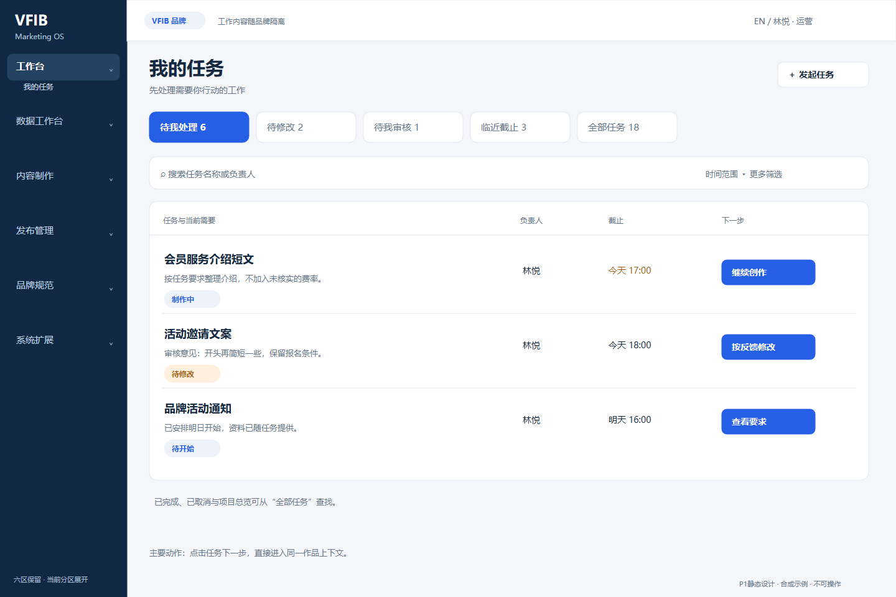
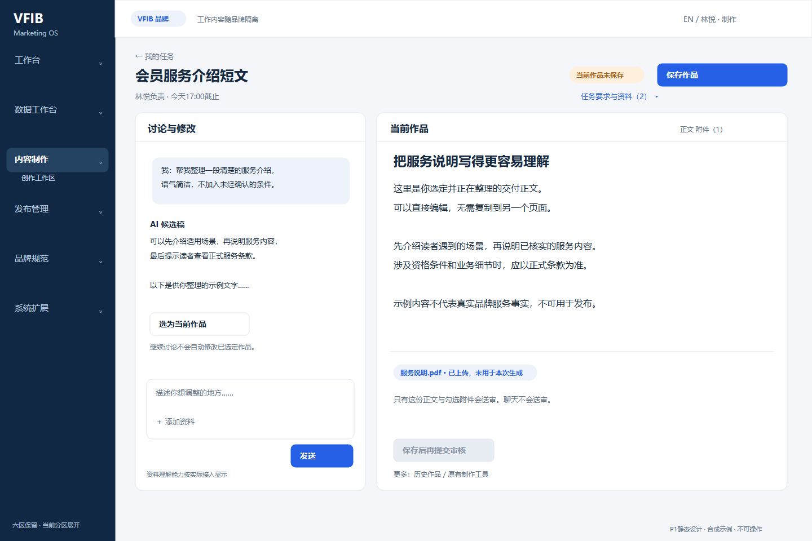
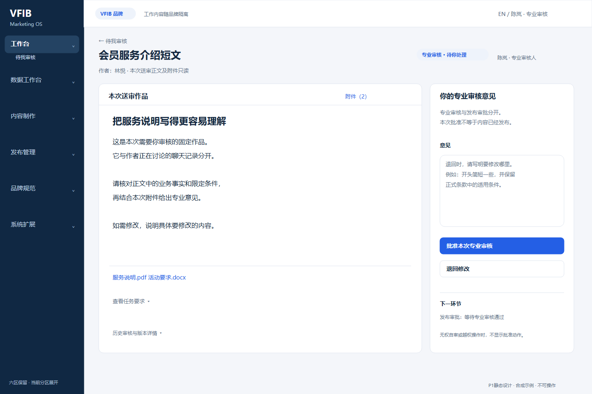
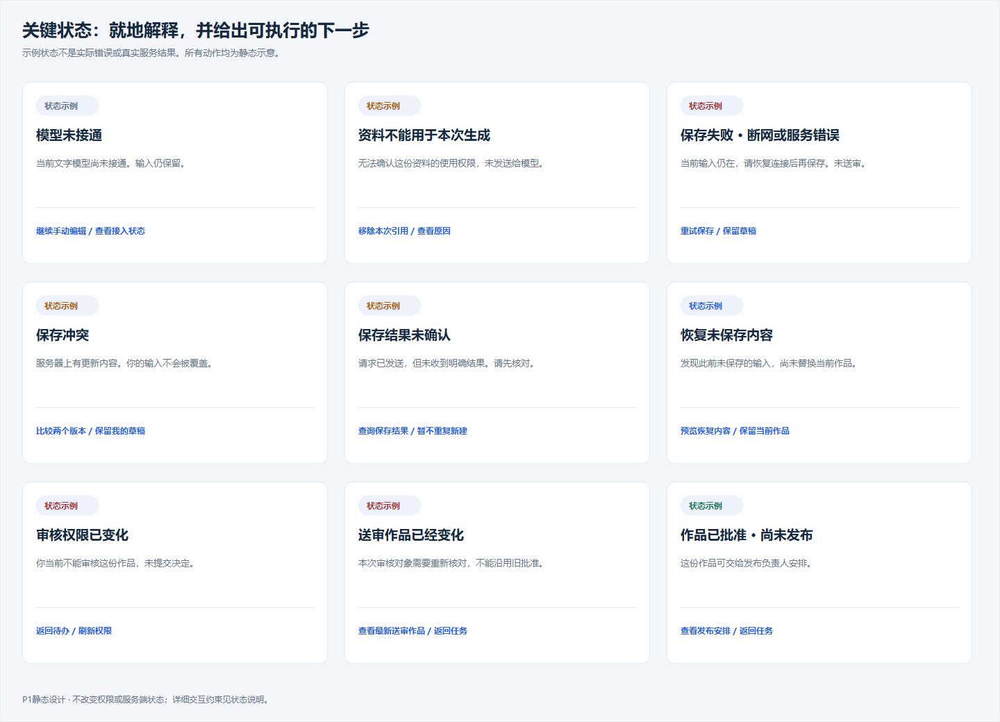

# P1 员工交互设计

日期：2026-11-02。基线4ab767d（P0）；分支codex/employee-experience-p1。

**本次交付是静态交互设计，不是P2可操作原型，也未替换本地9083应用。** 所有画面均为合成示例，图中姓名、任务、文件、计数和日期不来自真实业务库。

## 三个设计决定

1. 我的任务突出“下一步”，不要求员工先研究业务对象。
2. 创作区把“讨论”和“当前作品”放在同一工作表面；选稿、保存、送审有明确边界。
3. 审核先看固定作品与附件，再给意见和决定；专业审核、发布审批仍分开。

六区业务入口保留，默认只展开当前分区；没有新增三个管理中心。普通员工不配置模型参数、输入技术ID或查看hash完成工作。

## 桌面设计图

### 我的任务

### 创作工作区

### 作品审核

## 手机设计图（390px）

[我的任务](boards/04-my-tasks-mobile.png) · [创作工作区](boards/05-creative-mobile.png) · [作品审核](boards/06-review-mobile.png)

## 实施所需说明

- [布局、导航与操作流](P1_01_INTERACTION_SPEC.md)
- [异常与状态行为](P1_02_STATE_BEHAVIOR.md)
- [窄屏、键盘与中英文规则](P1_03_ACCESSIBILITY_AND_COPY.md)
- [设计逻辑走查](P1_04_DESIGN_WALKTHROUGH.md)
- [P2交接及范围](P1_05_P2_HANDOFF.md)
- STATE_CATALOG.json：32个设计状态，不是新增数据库状态。
- COPY.zh-en.json：成对关键UI文案，尚未安装到业务资源。
- DESIGN_RENDER_EVIDENCE.json：Chrome渲染静态SVG的PNG尺寸与摘要，不是应用浏览器测试。

原始SVG及不含业务逻辑的本地gallery.html在boards/。图中按钮为绘图元素，不能点击；不连接任何API。脚本只生成和渲染设计文件，不运行第三方项目或修改业务。

P1完成后停止，等待设计审核。P2、依赖安装、真实API及任何生产切换没有自动开始。

本轮设计一致性核对11/11通过：7张图、32个状态、95组成对中英文关键文案。该结果仅覆盖文档/图稿/资源一致性，不是应用功能或员工可用性验收。
