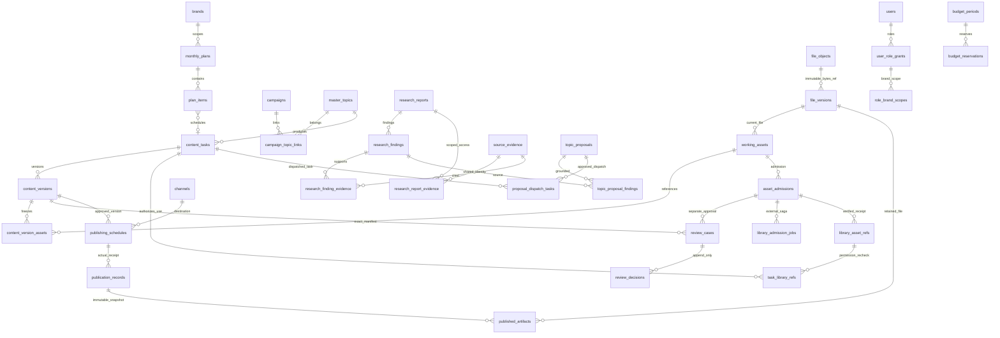

# PG02 PostgreSQL目标模型与SQL草案

设计日期：2026-10-27。唯一分析基线：`7f05078614a789b94a040f67b18e462f2284f063`，分支 `baseline/consolidation-phase2`，仓库 `475022876/watu-operation`。开始时HEAD、origin远程分支及干净工作树一致。应用0.1.6、mosSchemaVersion=8保持不变。

本轮是 **Phase 3A-1设计**：没有导入应用store、启动业务服务、读取生产JSON内容、安装依赖/PostgreSQL、执行SQL、迁移数据或修改任何业务源码。Phase 2的990项记录是既有隔离证据，本轮只核对源码及证据，不将其说成PostgreSQL测试通过。SQL是待评审草案，未在数据库解析或执行；本轮静态检查不能代替下一阶段迁移/约束/RLS验收。

## 规模与边界

建议 **74张业务及支撑表=43张主表+15张关系/明细表+16张运行支撑表**，不含迁移工具自身版本登记表、临时staging、索引、视图或函数。74是此草案的可审查范围，不是必须一次全部手写完或已经建表。禁止单个JSONB大表承接mos.json。完整字段/类型在POSTGRESQL_SCHEMA_DRAFT.sql及TABLE_CATALOG.json；SQL全量表定义、外键、唯一键、状态检查和RLS示例均未执行。

核心模型不变：计划—活动—MasterTopic—任务—内容版本—专业/发布审核—排期—发布/快照；情报—报告—发现/证据—候选选题—人工批准；工作素材—准入申请—独立最终审核—Workspace回执/引用。数据库不成为Workspace审批或权限的替代权威。

## 统一类型、键、品牌和审计约定

- 原业务ID为text，保留现有uid/手工演示ID；brands以code为PK。无id的关系、会话元数据等用确定性迁移id，DTO不增加原来不存在的字段。table id不承担展示编号。
- 品牌业务表brand_code NOT NULL，引用品牌表code；同品牌父子使用(brand_code,id)复合FK，不能只按id外键而放任跨品牌。全局users/角色/配置通过专用权限通道；source_evidence以授权报告关系隔离；全局审计/探针/失效记录的brand可NULL，必须显式特殊策略。
- mutable行row_version和updated_at：CAS每次+1；旧行缺版本的迁移默认1只可用于原本未定义版本的行，旧字段已存在却非法时拒绝。业务版本number与row_version独立。created_at/created_by_ref、updated_at/updated_by_ref及demo属于审计基础；没有历史值时created_at保留NULL，技术recorded_at记录入库时刻；DTO不输出原来不存在的历史字段，不伪造真实业务时间。
- 真实时间用timestamptz，日历日期用date；排期原串、local timestamp、timezone/precision和可证实UTC并存。毫秒epoch会话时间按毫秒转换。PostgreSQL输出Date/JSONB/numeric/bigint须通过DTO codec保持旧API类型和格式。
- 钱为numeric(20,6)，指标为numeric(28,6)，字节/计数为bigint；NULL未知费用不变0；不换汇或重建虚假费用。API仍输出原number/null，在安全范围内明确转换，不全局改pg类型解析并丢精度。
- FK默认RESTRICT，不级联删除历史；用户软停用不删除，历史actor缺失时保留actor_ref并将可空actor_user_id设NULL，禁止制造Active用户。真正任务负责人缺失属于阻断项。
- audit_events/review_decisions/admission_history/发布快照为追加或冻结记录：运行角色禁止UPDATE/DELETE；状态迁移继续由原业务状态机控制。SQL草案尚需不可变/追加触发器和最小GRANT评审，不能直接拿草案上线。

## 74表概览

|表|类别|PK / 附加唯一键|主要FK|查询索引/版本|
|---|---|---|---|---|
|brands|core|code；无未经确认的自然唯一键|—|PK/FK索引；row_version|
|users|core|id:text；无未经确认的自然唯一键|—|PK/FK索引；row_version|
|user_role_grants|core|id:text；无未经确认的自然唯一键|`user_id`→users; `role_code`→role_definitions|PK/FK索引；row_version|
|auth_sessions|core|id:text；token_digest|`user_id`→users|PK/FK索引；row_version|
|monthly_plans|core|id:text；brand_code,year,month,version / brand_code,code|`owner_id`→users; `brand_code,supersedes_id`→monthly_plans|PK/FK索引；row_version|
|plan_items|core|id:text；无未经确认的自然唯一键|`brand_code,plan_id`→monthly_plans; `brand_code,content_task_id`→content_tasks|brand_code,work_date；row_version|
|campaigns|core|id:text；brand_code,code|`owner_id`→users|PK/FK索引；row_version|
|monthly_campaign_links|core|id:text；brand_code,plan_id,campaign_id|`brand_code,plan_id`→monthly_plans; `brand_code,campaign_id`→campaigns|PK/FK索引；row_version|
|master_topics|core|id:text；无未经确认的自然唯一键|`owner_id`→users|PK/FK索引；row_version|
|campaign_topic_links|core|id:text；brand_code,campaign_id,topic_id|`brand_code,campaign_id`→campaigns; `brand_code,topic_id`→master_topics|PK/FK索引；row_version|
|content_tasks|core|id:text；code|`owner_id`→users; `brand_code,campaign_id`→campaigns; `brand_code,topic_id`→master_topics; `brand_code,parent_task_id`→content_tasks|brand_code,owner_id,status; brand_code,production_due；row_version|
|source_registry|core|id:text；无未经确认的自然唯一键|`owner_id`→users|brand_code,status,next_run_at；row_version|
|source_items|core|id:text；无未经确认的自然唯一键|`brand_code,source_id`→source_registry|brand_code,source_id,fetched_at; brand_code,canonical_url_hash；row_version|
|evidence_references|core|id:text；无未经确认的自然唯一键|`brand_code,source_item_id`→source_items; `brand_code,topic_id`→master_topics; `brand_code,content_version_id`→content_versions|PK/FK索引；row_version|
|skill_versions|core|id:text；brand_code,skill_code,version|—|PK/FK索引；row_version|
|creative_templates|core|id:text；brand_code,template_code,version|`brand_code,skill_version_id`→skill_versions|PK/FK索引；row_version|
|content_versions|core|id:text；brand_code,content_task_id,number / code / brand_code,id,manifest_hash|`author_id`→users; `brand_code,content_task_id`→content_tasks; `brand_code,supersedes_id`→content_versions; `brand_code,superseded_by_id`→content_versions|PK/FK索引；row_version|
|review_cases|core|id:text；brand_code,id,version_hash / brand_code,id,content_version_id / brand_code,id,asset_admission_id|`brand_code,content_version_id`→content_versions; `brand_code,asset_admission_id`→asset_admissions; `brand_code,content_version_id,version_hash`→content_versions|brand_code,state,type；row_version|
|review_decisions|core|id:text；无未经确认的自然唯一键|`actor_id`→users; `brand_code,case_id`→review_cases; `brand_code,case_id,version_hash`→review_cases; `brand_code,case_id,content_version_id`→review_cases; `brand_code,case_id,asset_admission_id`→review_cases|PK/FK索引；row_version|
|working_assets|core|id:text；无未经确认的自然唯一键|`owner_id`→users; `brand_code,task_id`→content_tasks; `brand_code,campaign_id`→campaigns; `brand_code,topic_id`→master_topics; `brand_code,generation_job_id`→generation_jobs; `brand_code,file_version_id`→file_versions|PK/FK索引；row_version|
|generation_jobs|core|id:text；无未经确认的自然唯一键|`requested_by`→users; `brand_code,task_id`→content_tasks; `brand_code,skill_version_id`→skill_versions; `brand_code,template_id`→creative_templates|brand_code,status,created_at；row_version|
|video_artifacts|core|id:text；brand_code,task_id|`brand_code,task_id`→content_tasks; `brand_code,final_asset_id`→working_assets|PK/FK索引；row_version|
|channels|core|id:text；无未经确认的自然唯一键|`owner_id`→users|PK/FK索引；row_version|
|publishing_schedules|core|id:text；无未经确认的自然唯一键|`brand_code,content_version_id`→content_versions; `brand_code,channel_id`→channels|brand_code,planned_at_utc,state；row_version|
|publication_records|core|id:text；无未经确认的自然唯一键|`brand_code,schedule_id`→publishing_schedules; `brand_code,content_version_id`→content_versions; `brand_code,channel_id`→channels|PK/FK索引；row_version|
|published_artifacts|core|id:text；无未经确认的自然唯一键|`brand_code,publication_id`→publication_records; `brand_code,file_version_id`→file_versions|PK/FK索引；row_version|
|publication_corrections|core|id:text；无未经确认的自然唯一键|`brand_code,publication_id`→publication_records; `brand_code,replacement_publication_id`→publication_records|PK/FK索引；row_version|
|publication_metrics|core|id:text；无未经确认的自然唯一键|`brand_code,publication_id`→publication_records; `brand_code,channel_id`→channels|brand_code,publication_id,as_of；row_version|
|asset_admissions|core|id:text；无未经确认的自然唯一键|`brand_code,working_asset_id`→working_assets|PK/FK索引；row_version|
|library_asset_refs|core|id:text；无未经确认的自然唯一键|`brand_code,admission_id`→asset_admissions; `brand_code,working_asset_id`→working_assets|brand_code,library_id；row_version|
|ingest_jobs|core|id:text；无未经确认的自然唯一键|`brand_code,source_id`→source_registry|brand_code,status,next_run_at；row_version|
|research_reports|core|id:text；code|`requester_id`→users; `brand_code,job_id`→research_jobs|PK/FK索引；row_version|
|research_findings|core|id:text；brand_code,id,report_id|`brand_code,report_id`→research_reports; `brand_code,source_item_id`→source_items|PK/FK索引；row_version|
|source_evidence|core|id:text；无未经确认的自然唯一键|`source_id`→source_registry|PK/FK索引；row_version|
|topic_proposals|core|id:text；code|`created_by_id`→users; `brand_code,report_id`→research_reports; `brand_code,topic_id`→master_topics|PK/FK索引；row_version|
|research_jobs|core|id:text；code|`actor_id`→users; `brand_code,report_id`→research_reports|PK/FK索引；row_version|
|provider_calls|core|id:text；无未经确认的自然唯一键|—|brand_code,created_at; provider,state,created_at；row_version|
|video_render_jobs|core|id:text；无未经确认的自然唯一键|`actor_id`→users; `brand_code,task_id`→content_tasks; `brand_code,file_version_id`→file_versions|PK/FK索引；row_version|
|library_ticket_cache|core|id:text；ticket_key|—|PK/FK索引；row_version|
|library_event_cursors|core|id:text；brand_code|—|PK/FK索引；row_version|
|library_invalidations|core|id:text；brand_code,kind,target_id|—|PK/FK索引；row_version|
|library_admission_jobs|core|id:text；brand_code,admission_id|`brand_code,admission_id`→asset_admissions|PK/FK索引；row_version|
|audit_events|core|id:text；无未经确认的自然唯一键|`actor_user_id`→users|brand_code,occurred_at; correlation_id；row_version|
|role_brand_scopes|relation|id:text；grant_id,scope_brand_code|`grant_id`→user_role_grants; `scope_brand_code`→brands|PK/FK索引；row_version|
|task_library_refs|relation|id:text；brand_code,task_id,library_ref_id|`brand_code,task_id`→content_tasks; `brand_code,library_ref_id`→library_asset_refs|PK/FK索引；row_version|
|content_version_assets|relation|id:text；brand_code,content_version_id,asset_id|`brand_code,content_version_id`→content_versions; `brand_code,asset_id`→working_assets; `brand_code,file_version_id`→file_versions|PK/FK索引；row_version|
|content_version_channels|relation|id:text；brand_code,content_version_id,channel_id|`brand_code,content_version_id`→content_versions; `brand_code,channel_id`→channels|PK/FK索引；row_version|
|content_version_evidence|relation|id:text；brand_code,content_version_id,evidence_reference_id|`brand_code,content_version_id`→content_versions; `brand_code,evidence_reference_id`→evidence_references|PK/FK索引；row_version|
|generation_job_outputs|relation|id:text；brand_code,job_id,asset_id|`brand_code,job_id`→generation_jobs; `brand_code,asset_id`→working_assets|PK/FK索引；row_version|
|video_storyboard_shots|relation|id:text；brand_code,video_artifact_id,ordinal|`brand_code,video_artifact_id`→video_artifacts; `brand_code,asset_id`→working_assets|PK/FK索引；row_version|
|research_finding_evidence|relation|id:text；brand_code,finding_id,evidence_id|`brand_code,finding_id`→research_findings; `brand_code,report_id`→research_reports; `evidence_id`→source_evidence; `brand_code,finding_id,report_id`→research_findings; `brand_code,report_id,evidence_id`→research_report_evidence|PK/FK索引；row_version|
|topic_proposal_findings|relation|id:text；brand_code,proposal_id,finding_id|`brand_code,proposal_id`→topic_proposals; `brand_code,finding_id`→research_findings|PK/FK索引；row_version|
|proposal_dispatch_tasks|relation|id:text；brand_code,proposal_id,task_id|`brand_code,proposal_id`→topic_proposals; `brand_code,task_id`→content_tasks; `brand_code,plan_item_id`→plan_items|PK/FK索引；row_version|
|asset_admission_history|relation|id:text；brand_code,admission_id,ordinal|`actor_id`→users; `brand_code,admission_id`→asset_admissions|PK/FK索引；row_version|
|research_report_brands|relation|id:text；brand_code,report_id,ordinal|`brand_code,report_id`→research_reports; `visible_brand_code`→brands|PK/FK索引；row_version|
|video_keyframe_assets|relation|id:text；brand_code,video_artifact_id,ordinal|`brand_code,video_artifact_id`→video_artifacts; `brand_code,asset_id`→working_assets|PK/FK索引；row_version|
|campaign_library_refs|relation|id:text；brand_code,campaign_id,claim_path,ordinal|`brand_code,campaign_id`→campaigns; `brand_code,library_ref_id`→library_asset_refs|PK/FK索引；row_version|
|research_report_evidence|relation|id:text；brand_code,report_id,evidence_id|`brand_code,report_id`→research_reports; `evidence_id`→source_evidence|PK/FK索引；row_version|
|file_objects|ops|id:text；brand_code,storage_backend,bucket_ref,object_key|—|PK/FK索引；row_version|
|file_versions|ops|id:text；brand_code,object_id,version_no|`brand_code,object_id`→file_objects|PK/FK索引；row_version|
|upload_sessions|ops|id:text；无未经确认的自然唯一键|`brand_code,object_id`→file_objects; `brand_code,file_version_id`→file_versions|PK/FK索引；row_version|
|provider_configs|ops|id:text；kind|—|PK/FK索引；row_version|
|provider_budget_policies|ops|id:text；scope_key,kind|—|PK/FK索引；row_version|
|budget_periods|ops|id:text；brand_code,policy_id,period_start|`policy_id`→provider_budget_policies|PK/FK索引；row_version|
|budget_reservations|ops|id:text；brand_code,invocation_key|`brand_code,period_id`→budget_periods|PK/FK索引；row_version|
|outbox_events|ops|id:text；brand_code,dedupe_key|—|PK/FK索引；row_version|
|inbox_events|ops|id:text；brand_code,provider,stream_key,event_key|—|PK/FK索引；row_version|
|idempotency_requests|ops|id:text；brand_code,actor_id,operation,resource_key,idempotency_key|`brand_code,proposal_id`→topic_proposals|PK/FK索引；row_version|
|migration_runs|ops|id:text；source_sha256,mapping_version|—|PK/FK索引；row_version|
|migration_rejections|ops|id:text；无未经确认的自然唯一键|`run_id`→migration_runs|PK/FK索引；row_version|
|system_settings|ops|id:text；setting_key|—|PK/FK索引；row_version|
|code_counters|ops|id:text；counter_key|—|PK/FK索引；row_version|
|role_definitions|ops|id:text；role_code|—|PK/FK索引；row_version|
|role_permissions|ops|id:text；role_code,permission_code|`role_code`→role_definitions|PK/FK索引；row_version|

## 关系型拆分及JSONB分工

15张明细分别为：角色品牌scope、任务资料引用、版本素材、版本渠道、版本证据、生成输出、视频分镜、发现证据、候选来源发现、派工结果任务、入库history、报告品牌scope、视频关键帧、Campaign资料引用、报告证据。

JSONB用于有界文档：营销Brief、prompt/rule/manifest快照、模板非执行配置、审核requirements、视频脚本/字幕/镜头描述、报告机会/缺口/模型执行元数据、经过脱敏的回执与事件payload、用户prefs。授权引用、外键、状态、预算、金额、排期筛选、关键版本号必须是列/关系。当前publication_metrics是标量，不能机械改为JSONB；仅额外平台扩展可用有schema的platform_extensions。

每表legacy_extra仅收纳经分类的非关键兼容余项，不得复制整条原JSON对象、凭据或业务关系，不能作为通用读写主载体。下一阶段字段登记器要求每一个源字段明确属于typed列/有schema文档/子关系/获批准归档或拒绝项，否则迁移失败。完整原始字节只在加密只读源快照保留，不能以丢字段取得兼容。

## 关键特殊约束

内容版本唯一(task,number)，同品牌FK；review_cases内容主体同时绑定(content_version_id,version_hash)到冻结manifest，decisions必须与case类型/主体/hash一致。资产准入的subject_snapshot另行冻结，不能把assetSha256误当全部准入元数据hash。三条审核链不合并成一个approved字段。

review_cases旧内容hash为空/与目标不一致、历史准入快照不可重建时不能直接导成有效批准；保持原历史并列出隔离问题，人工解决后才允许切换，不自动补批准。发布必须仍检查当前冻结版本、渠道、专业审核、发布批准和素材READY；FK和CHECK不能独立证明业务审核通过。

source_evidence保持全局ID，但运行账号无全局访问；经research_report_evidence以及原主品牌授权读取。发现证据关联用报告/证据复合FK。来源表品牌与报告品牌不一致、无任何消费者或未知访问范围的证据进入隔离；不会默认归属VFIB或向所有品牌公开。报告完整brandScope列表保留，现有仅首品牌可访问的行为不因拆表自动放宽。

原manifest hash保持原值和canonical原文，不以jsonb::text重算。JSONB键序/空白/数值输出不是JS stableStringify；冻结对象必须用原算法验证，禁止迁移时重新签发批准。

## RLS建议与实现边界

建议对品牌业务表启用RLS+FORCE ROW LEVEL SECURITY，作为遗漏WHERE brand条件的防线；应用RBAC仍做动作权限、当前用户、职责分离和当前授权校验。运行角色不能是表owner、superuser或BYPASSRLS；RLS默认拒绝及owner例外见[PostgreSQL官方说明](https://www.postgresql.org/docs/18/ddl-rowsecurity.html)。

每个已认证请求在同一client事务内set_config(...,true)设置actor/brand；身份来自已验证会话，禁止信任请求体actorId。未设置上下文或actor停用/撤权即拒绝；空上下文不等于全品牌。COMMIT/ROLLBACK清除局部上下文，归还池前重置，异常连接销毁。SQL injection或持有应用DB凭据者能伪设GUC，因此RLS不等于可信身份来源，参数化SQL和凭据保护仍必要。

草案包含会员检查函数和品牌RLS示例；全局/nullable-brand/身份bootstrap/证据写入仍按默认无GRANT阻断，须在Phase3A-2补齐限定函数和策略后才可执行。安全definer函数固定search_path、撤销PUBLIC执行、专用NOLOGIN guard角色只读授权元数据，不授予全库访问。RLS查询不可递归引用其自身策略表；DBA备份/恢复走受控专用角色。

## 文件模型及恢复

file_objects标识逻辑对象/后端/存储键/品牌；file_versions标识不可变版本、SHA256、字节数、MIME、校验时刻和上传状态；upload_sessions记录临时上传。working_assets和published_artifacts以同品牌FK引用明确文件版本。文件留在既有uploads/published路径，首轮仅登记与校验，不搬移/删除、不强制部署新对象存储。

状态草案UPLOADING→STAGED→VERIFIED→READY；文件先写临时位置并校验，短事务写READY引用。崩溃前后通过session、hash、存储清单对账：未引用对象标记ORPHAN_PENDING并隔离待人工批准，已引用缺文件标记MISSING并阻断发布。对象存储与PG不能构成单一原子提交；Outbox完成后续动作，孤儿对账负责补偿。发布快照保留独立不可变版本，不变成指向可编辑原素材的链接。二进制、视频、base64媒体不入普通业务JSONB。

## 关键实体关系图

图中是关键链路子集；完整74表和所有外键以TABLE_CATALOG.json/SQL为准。外部Workspace资产不是本库实体的可级联FK；以外部ID和实时授权核验保持隔离。
